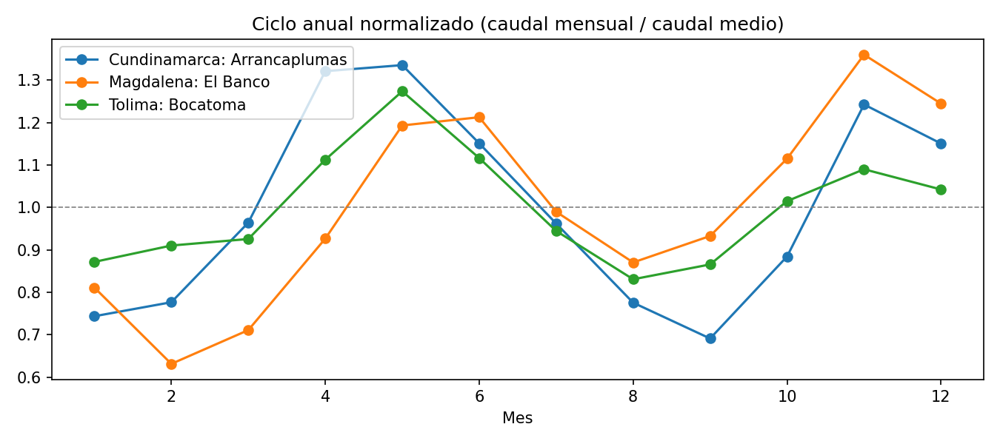
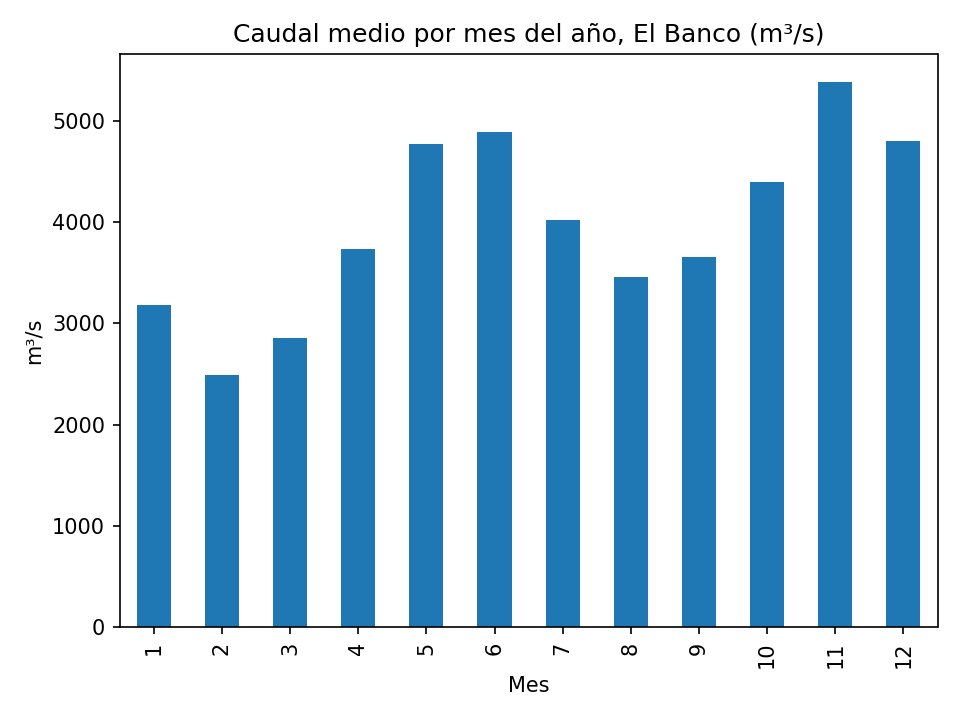
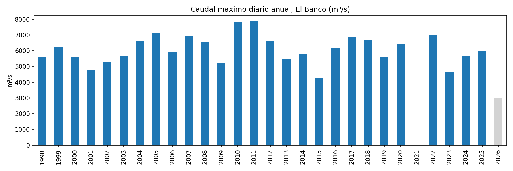

# Análisis de caudales diarios del IDEAM

Control de calidad y análisis exploratorio de series de caudal medio diario de 14 estaciones de 3 departamentos (Tolima, Cundinamarca y Magdalena), con Python y Pandas. Incluye limpieza, comparación de estaciones, selección de la mejor estación por departamento, ciclo anual y máximos anuales.

## Objetivo

Aplicar a datos hidrológicos reales un flujo de trabajo reproducible que antes se hacía a mano en Excel: carga, revisión de calidad, tratamiento de vacíos, estadísticas y gráficos.

## Datos

- **Fuente:** IDEAM, portal de consulta y descarga de datos hidrometeorológicos (DHIME).
- **Variable:** caudal medio diario (m³/s).
-- **Estaciones (14):**
  - Tolima: Anchique, Angostura, Bocatoma [21217250] y Bocatoma [23017020]
  - Cundinamarca: Arrancaplumas, El Profundo, Puerto Salgar y Tobia
  - Magdalena: Canal Florida, El Banco, Ganadería Caribe, Guachaca, Hacienda Puerto Rico y Puente Ferrocarril
  - **Periodo:** los archivos cubren desde 1998; el fin del registro varía según la estación (hasta 2026 como máximo). Las tres estaciones elegidas cubren: Arrancaplumas 1998-2014, Bocatoma [21217250] 1998-2018 y El Banco 1998-2026.

## Metodología

1. **Carga y estructura.** Lectura de los CSV por departamento (subcarpeta), conversión de fechas, eliminación de fechas duplicadas y reindexación a un registro por día para hacer visibles los vacíos.
2. **Limpieza.** Interpolación temporal solo en huecos de 5 días o menos. Los huecos más largos no se rellenan.
3. **Criterio de calidad.** Un año es confiable si tiene al menos 90 % de sus días con dato. Una estación es apta si tiene menos de 15 % de faltantes tras la limpieza y al menos 20 años confiables.
4. **Selección.** Dentro de cada departamento se elige la estación apta con menos faltantes, luego más años confiables y luego el hueco más corto.
5. **Comparación.** Las mejores estaciones se comparan en su periodo común, con un ciclo anual normalizado para poder contrastar ríos de distinto tamaño.
6. **Máximos anuales y periodo de retorno empírico** (Weibull) de la estación del análisis detallado.
7. **SQL.** Las series se cargan en SQLite para practicar consultas de agrupación.

## Resultados

### Comparación de estaciones

Tabla completa: [resultados/comparacion_estaciones.csv](Resultados/comparacion_estaciones.csv)

### Mejor estación por departamento

| Estación | Departamento | Faltantes tras limpieza (%) | Años confiables | Hueco más largo (días) |
|:---------|:-------------|---------------------------:|----------------:|-----------------------:|
| Arrancaplumas [21237020] | Cundinamarca | 0,8 | 16 | 29 |
| Bocatoma [21217250] | Tolima | 3,0 | 16 | 88 |
| El Banco [25027020] | Magdalena | 3,7 | 27 | 365 |

En cada departamento se eligió la estación apta con menos datos faltantes, según el criterio de la metodología. El Banco tiene más años confiables que las otras dos, pero también el hueco más largo (365 días, un año completo sin datos).

En el ciclo anual normalizado (caudal mensual dividido por el caudal medio de cada estación), las tres estaciones elegidas (Arrancaplumas, en Cundinamarca; El Banco, en Magdalena; y Bocatoma, en Tolima) muestran un régimen bimodal, con dos temporadas de caudales altos y dos de caudales bajos. Las tres superan su media en mayo, junio, noviembre y diciembre, y quedan por debajo de ella entre enero y marzo y entre julio y septiembre.

Las diferencias están en el momento y la intensidad de los picos: Arrancaplumas y Bocatoma alcanzan su máximo en mayo (1,34 y 1,27 veces su media), mientras que El Banco lo alcanza en noviembre (1,36). Los mínimos también varían: febrero en El Banco (0,63), septiembre en Arrancaplumas (0,69) y agosto en Bocatoma (0,83). Bocatoma tiene el ciclo más suave y El Banco el más contrastado.

Los gráficos muestran caudales, no precipitación, por lo que su relación con las temporadas de lluvia es una interpretación y no un resultado de este análisis. Las diferencias de El Banco, una estación de caudal mucho mayor que las otras dos, podrían deberse a que integra aportes de una cuenca más extensa, pero esa hipótesis no se verificó.

### Estación del análisis detallado: El Banco [25027020]

**Ciclo anual.** El régimen es bimodal: el caudal medio mensual tiene dos temporadas altas, de mayo a junio (cerca de 4.800 a 4.900 m³/s) y de octubre a diciembre, con el máximo en noviembre (cerca de 5.400 m³/s). Los meses más bajos son de enero a marzo, con el mínimo en febrero (cerca de 2.500 m³/s), y hay una baja secundaria en agosto y septiembre (cerca de 3.500 a 3.700 m³/s).

**Máximos anuales.** El máximo del registro ocurrió el 6 de mayo de 2011, con 7.861 m³/s, y es consistente con el periodo lluvioso de 2010-2011 en Colombia. Se excluyeron dos años por tener menos de 90 % de datos: 2021, que no tiene datos, y 2026, que solo tiene el 1 de enero (barra gris en la figura).

| Año | Máximo diario (m³/s) | Completitud | T empírico (años) |
|----:|---------------------:|------------:|------------------:|
| 2011 | 7.861 | 100 % | 28,0 |
| 2010 | 7.860 | 100 % | 14,0 |
| 2005 | 7.140 | 100 % | 9,3 |
| 2022 | 6.975 | 100 % | 7,0 |
| 2007 | 6.902 | 100 % | 5,6 |

**Observaciones.**

- Los máximos de 2010 y 2011 difieren en apenas 1 m³/s, de modo que su periodo de retorno (14 frente a 28 años) depende solo del orden del ranking. Es una referencia empírica, no un valor de diseño.
- Los valores antiguos de la serie son enteros y algunos recientes tienen decimales (por ejemplo, 2022). Podría deberse a un cambio en la forma de registro del dato; es una observación sin verificar.

## Limitaciones

- Los datos son **preliminares** y cubren el periodo descargado.
- La mejor estación de un departamento es la de mejor calidad de datos, no necesariamente la más representativa: un río puede cruzar varios departamentos.
- El periodo de retorno de Weibull es una referencia empírica y **no sirve para diseño**. Un estudio real usaría distribuciones de frecuencia (Gumbel, Log-Pearson III) con series más largas.
- Los máximos de los años con huecos pueden estar subestimados; los años con menos de 90 % de datos se excluyeron.
- La interpolación en huecos cortos supone variación suave del caudal, lo que puede no cumplirse durante una creciente.
- Las comparaciones entre estaciones se hacen en el periodo común, que puede ser corto si alguna estación tiene un registro reciente.

## Cómo reproducirlo

1. Descargar las series del portal DHIME del IDEAM (caudal medio diario) y guardarlas en `datos/<departamento>/`.
2. Instalar las dependencias: `pip install pandas matplotlib jupyter`.
3. Abrir `PROYECTO_IDEAM_V5.ipynb`, editar la celda de parámetros y ejecutar con **Kernel > Restart & Run All**.

## Herramientas

Python, Pandas, Matplotlib, SQLite y Jupyter Notebook.

## Autor

Juan Carlos Acero Moreno · Ingeniero Civil, especialista en Recursos Hidráulicos y Medio Ambiente · [LinkedIn](https://www.linkedin.com/in/juan-carlos-acero-moreno)
